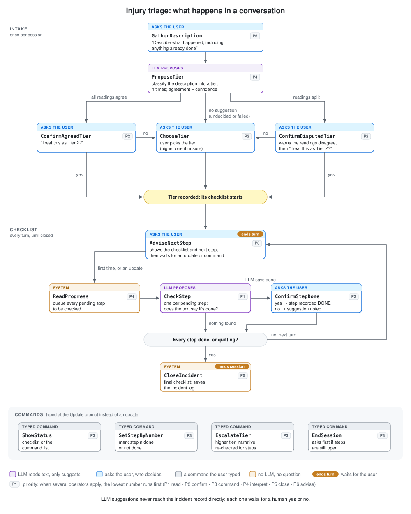

# Technical Approach

This demo is a conversational agent built with [`cognition`](https://github.com/polycog/cognition), a library for building neurosymbolic agents. It addresses the problem described in the [use case](usecase.md): guiding school staff through a student injury policy in real time, with guaranteed adherence to the policy's steps and deadlines.

## Approach

The agent splits the work between two kinds of reasoning, so that each does what it does best:

- **Neural reasoning understands language.** An LLM turns what staff type into the policy's own terms: a suggested `Tier` for the description, or a yes/no on whether one named step has been done. These answers are only proposals. The LLM never writes to the incident record, never decides what happens next, and never sees what staff have already confirmed.
- **Symbolic reasoning decides.** The policy is encoded as data, and WHEN/THEN operators, ranked by priority, enforce it: they decide which steps the LLM checks, put each proposal to staff as a yes/no question, build the checklist and deadlines, and give the earliest unfinished step as the next one. No LLM takes part in these decisions, so the same state always leads to the same action, and every step can be traced.

Three design choices follow from this split:

- **Human confirmation.** Only a staff member's yes writes an LLM proposal into the incident record ([`record.py`](../injury_triage/record.py)), and each fact records whether it was suggested by the assistant and confirmed, or entered directly.
- **Works without the LLM.** If the model fails or cannot decide, staff pick the tier from a list and mark steps with `done <n>`. The policy is enforced the same way either way.
- **Policy as data.** Tiers, criteria, checklists and deadlines live in one file, [`policy.py`](../injury_triage/policy.py). The operators and LLM prompts are derived from it; nothing about the policy is hard-coded elsewhere.

## Example

A staff member types:

> *"Fell and hit her head on the slide; the nurse checked her."*

1. **Neural.** `ProposeTier` asks the LLM to classify the description three times. All three readings say *Tier 2: Significant* (any head injury).
2. **Symbolic.** `ConfirmAgreedTier` asks *"Treat this as Tier 2: Significant?"*. Staff say yes, and the Tier 2 checklist starts. `AdviseNextStep` shows the checklist and the next step: *"Step 1: Nurse evaluates the student."*
3. **Neural.** `ReadProgress` queues each pending step, and `CheckStep` asks the LLM, one step at a time, whether the description says it was done. It finds step 1.
4. **Symbolic.** `ConfirmStepDone` asks *"It sounds like step 1 is done: "Nurse evaluates the student." Correct?"*. Staff say yes, so step 1 is marked done, and `AdviseNextStep` moves on to step 2, *"Call parent before student returns to class or leaves"*, and waits for the next update.

Had the readings disagreed, `ConfirmDisputedTier` would have warned staff before asking, and had staff rejected the suggestion, `ChooseTier` would have let them pick, reminding them to choose the higher tier when unsure. Had the LLM wrongly reported a step done, the staff member's no would have kept it pending.

## Decision process

There is no scripted flow. Each cycle, every operator whose WHEN holds is proposed, and the one with the lowest priority runs. One user turn ends when `AdviseNextStep` waits for input or `CloseIncident` ends the session.

| Priority | Operators | Role |
|---|---|---|
| P1 `READ` | `CheckStep` (one per pending step) | Ask the LLM whether the text says this step was done |
| P2 `CONFIRM` | `ConfirmAgreedTier`, `ConfirmDisputedTier`, `ChooseTier`, `ConfirmStepDone` (one per proposed step) | Settle each LLM proposal with a yes/no, or let staff choose |
| P3 `COMMAND` | `ShowStatus`, `SetStepByNumber`, `EscalateTier`, `EndSession` | Act on a typed command |
| P4 `INTERPRET` | `ProposeTier`, `ReadProgress` | Let the LLM read new text |
| P5 `CLOSE` | `CloseIncident` | Save the log once every step is done or staff quit |
| P6 `ADVISE` | `GatherDescription`, `AdviseNextStep` | Ask for a description, or show the next step and wait |

The ranking encodes the policy's order of work: an update is fully read before anything is asked about it, proposals are settled before new text is read, and the agent only waits for input when nothing more urgent applies. Steps are checked and confirmed in policy order, so the earliest unfinished step is always the next one, and a skipped step resurfaces until it is done.

`EscalateTier` covers a situation that gets worse, such as a nosebleed that won't stop. It only moves up a tier, starts that tier's checklist, and re-reads everything staff have written, so steps already done can be confirmed again.

## The built-in policy

Each tier has criteria, which the LLM uses to classify a description, and an ordered checklist. Values in *italics* are the `[bracketed]` placeholders set under `[policy]` in [`config.toml`](../config.toml).

**Tier 1: Emergency** (red): life-threatening or possibly so: unresponsive, trouble breathing, severe bleeding, suspected neck or spine injury, seizure, severe allergic reaction, obvious major fracture.

| # | Step | Due |
|---|---|---|
| 1 | Call 911 right away. Don't wait for an administrator. | right away |
| 2 | Start first aid, CPR/AED, or emergency meds per protocol. | right away |
| 3 | Notify nurse and administrator. | right away |
| 4 | Administrator calls parent immediately. | right away |
| 5 | Notify *district office* within *1 hour*. | *1 hour* after the incident is entered |
| 6 | Report filed within *24 hours*. | *24 hours* after the incident is entered |

**Tier 2: Significant** (yellow): needs evaluation or outside care: any head injury, possible fracture or sprain, wound that may need stitches, eye or dental injury, student can't return to class.

| # | Step | Due |
|---|---|---|
| 1 | Nurse evaluates the student. | |
| 2 | Call parent before student returns to class or leaves. | before the student returns to class or leaves |
| 3 | Inform administrator same day. | end of today |
| 4 | Report filed by *end of next school day*. | next weekday at *15:30* |

**Tier 3: Minor** (green): first aid only: small scrape, minor bruise, nosebleed that stops, student returns to class.

| # | Step | Due |
|---|---|---|
| 1 | Give first aid. | |
| 2 | Record in nurse visit log. | |
| 3 | Notify parent same day by *note / call / app*. | end of today |

If unsure between two tiers, the policy says to choose the higher one.

## Code layout

| File | Role |
|---|---|
| [`policy.py`](../injury_triage/policy.py) | The policy as data: tiers, steps, deadlines, and the `[policy]` settings |
| [`operators.py`](../injury_triage/operators.py) | The decision process: every WHEN/THEN operator and its priority |
| [`state.py`](../injury_triage/state.py) | Work in progress: unread text, steps to check, proposals awaiting a yes/no, typed commands |
| [`record.py`](../injury_triage/record.py) | The incident record: confirmed facts only, with a timeline |
| [`language.py`](../injury_triage/language.py) | The only place the LLM is used: the tier classifier and the step checker |
| [`agent.py`](../injury_triage/agent.py) | Assembles state, operators, the clock sensor and the console actuator into an agent |
| [`console.py`](../injury_triage/console.py) | All interaction with staff, and the `--trace` view |
| [`reports.py`](../injury_triage/reports.py) | Saves the draft incident log as Markdown and JSON |

## Adapting the policy

To try a different policy, edit [`policy.py`](../injury_triage/policy.py):

- `Tier` holds the tiers and their criteria. The docstrings are part of the LLM prompt, so write them as clear definitions.
- `StepId` and `PolicyStep` describe each checklist step, and the step's description is what the LLM uses to decide whether it was reported done.
- `Deadline` and `POLICY` link steps to tiers and set when each one is due.

Simple values such as names and deadlines can be changed in `config.toml` without touching code. Run the tests after changing the policy.
